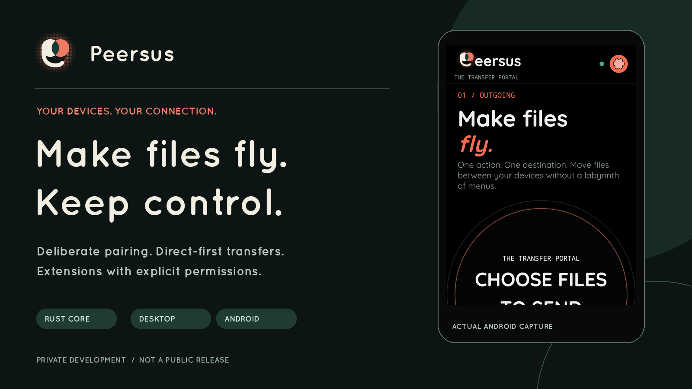
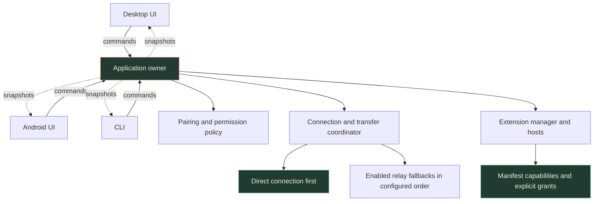
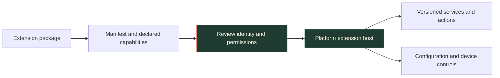

<p align="center">
  
</p>

<h1 align="center">Your devices. One deliberate connection.</h1>

<p align="center">
  A Rust-powered connection and transfer workspace for desktop and Android.<br>
  Pair deliberately. Transfer directly when possible. Give extensions only the access they need.
</p>

<p align="center">
  <strong>Private development · Unpublished · Apache-2.0</strong><br><br>
  <a href="#start-building">Build</a> ·
  <a href="#how-it-fits-together">Architecture</a> ·
  <a href="#extend-without-forking-the-app">Extensions</a> ·
  <a href="../docs/README.md">Documentation</a> ·
  <a href="../SECURITY.md">Security</a>
</p>

---

## Connection without the labyrinth

| Bring your devices together | Keep the decisions yours |
| :--- | :--- |
| **Direct-first connections** — retain configurable relay fallbacks, enable them independently and choose their order. | **Explicit trust** — deliberate pairing, incoming-transfer review and capability grants. |
| **One application owner** — the CLI, desktop and Android frontends share application contracts and transfer policy. | **Visible extension controls** — enable, restart, configure and review installed extensions without opening package details. |
| **Desktop + Android** — native frontends with platform-specific integration, not a desktop package relabelled for phones. | **Extensible by contract** — manifests describe capabilities, settings, actions and versioned services. |

> [!IMPORTANT]
> **This is a private development workspace, not a supported public release.** The screenshot above is from the actual Android application. A successful build does not establish runtime support on every platform. The extension store is available only when a maintainer trust key and a signed catalog are configured.

<details>
<summary><strong>Workspace metadata</strong> — generated from the actual project</summary>

<!-- STATUS-START -->
Workspace version: **0.1.0** (development; not a release claim). Rust toolchain: **1.96.1**; declared MSRV: **1.96**. License: **Apache-2.0**.
<!-- STATUS-END -->

</details>

## How it fits together

A single owner handles commands, snapshots, pairing, transport and transfers. Frontends present that state; they do not each invent a separate transfer policy.



**Direct-first is not a claim of zero relay contact:** signalling can use a relay before the transfer path is established. Configured fallbacks and their enabled state remain under your control.

[Architecture guide](../docs/architecture.md) · [Application and API contracts](../docs/api/README.md)

## Extend without forking the app

An extension declares what it offers and what it needs. The host assigns its identity and enforces grants. The interface renders those contracts instead of recognising a plugin by its display name.



Installed and available catalog entries share one list. Store membership stays visible across installation and removal, while installed-plugin configuration and actions remain directly accessible. Manual installation remains an explicit trust decision, not an assertion of official approval.

### Bundled extensions

“Bundled” describes packaging, not installation, activation or release readiness. The table below is generated from manifests; declared platforms are not proof of end-to-end validation.

> [!WARNING]
> **Cloud upload has not passed a live end-to-end upload test.** Android supports isolated WASM extensions, and the upload extension is built as one. The application itself carries no extension: nothing is built into the APK or installed at first start, and the person installs upload from the store or by hand through the ordinary package manager, which shows what it asks for and grants no file or HTTPS permission automatically. Native desktop and Android WASM builds share one upload identity and one catalog entry, with platform-specific artifacts selected inside that entry. Device picker/consent checks and live-upload acceptance remain separate from automated tests with synthetic host responses.

<!-- PLUGINS-START -->
| Bundled extension | Declared platforms | Exported services |
| --- | --- | --- |
| [peersus-clipboard](../crates/peersus-clipboard/plugin.json) | android, linux, macos | `clipboard.text` v1 |
| [peersus-upload](../crates/peersus-upload/plugin.json) | android, linux, macos | `upload.file` v1 |
<!-- PLUGINS-END -->

[Extension-store contract](../docs/extension-store.md) · [Security boundaries](../SECURITY.md)

## Start building

### Desktop development

Use the toolchain in `rust-toolchain.toml` and the platform prerequisites in the development guide. Cold builds compile Skia from source and need its compiler dependencies and network access.

```sh
./dev.sh desktop
```

Root helpers separate development builds, release-artifact preparation, checks, local store fixtures and website previews. They do not implicitly install applications or publish content.

[Development setup and helper reference](../docs/development.md#root-shell-helpers)

<details>
<summary><strong>Release-profile desktop build and Linux staging</strong></summary>

```sh
FORCE_SKIA_BUILD=1 cargo xtask build
./target/release/peersus-ui
```

This builds the owner, UI, extension hosts, store fetcher and bundled extension programs. Keep the helpers beside the owner. A custom `CARGO_TARGET_DIR` changes the output directory; building only the UI is not a complete distribution.

```sh
python3 scripts/stage-linux.py
```

Staging writes `<target-directory>/distribution/linux/` and refuses to overwrite an existing distribution. It does not install, sign or publish it.

</details>

### Android development

```sh
./dev.sh android
```

Android needs SDK 36, the compatible NDK, Java 17, `cargo-ndk` and the packaged Rust target ABIs. Minimum platform: **API 31**. Building and installing are separate operations; explicit device deployment verifies signing compatibility and preserves application data.

The community flavor enables native extensions. Do not assume the Play flavor has the same executable-extension policy. `cargo xtask android` prepares **unsigned** release artifacts; it does not sign, publish or install them.

[Android build and validation boundaries](../docs/development.md)

### CLI

```sh
./target/release/peersus --help
./target/release/peersus peers
./target/release/peersus plugins
```

Pairing, transfers, settings and plugin commands use the same application contracts. Consult each subcommand's `--help` for current syntax. Enter relay credentials through Settings, never through command arguments.

Everything the window can do is reachable without a dedicated subcommand: `peersus commands` lists every command the application accepts from outside, `peersus call '{"command":"test-link","peer":"…"}'` sends one exactly as the window does, `peersus state` prints the state the window draws from (`--watch` prints one line per change), and `peersus page <plugin> <page>` / `peersus page-event <plugin> <page> '<event>'` drive an extension's own page. `peersus status` gathers what a script waits on; `peersus answer <id> --accept --secret-stdin` answers an extension's question with a secret read from standard input, never from arguments. Internal commands that carry handles or platform facts are not accepted.

### Local diagnostics

The application owner and UI share first-party `tracing` configuration. Desktop output
uses a bounded, off-thread stderr writer; keep the initialization guard alive until
shutdown. Queue overflow can drop records and is exposed by the guard's counter.
Android uses the native Logcat backend, not an assumed stderr redirect. Neither
backend opens a listener or sends telemetry. Isolated helpers retain their fixed,
payload-free stderr failure contracts.

Normal output is warn/error. On desktop, `PEERSUS_LOG=peersus_app::runtime=debug`
enables owner context; `PEERSUS_LOG=peersus_ui::gesture=trace` enables local gesture
coordinates and decisions. Third-party targets remain excluded even with `trace`.
An invalid filter falls back to safe defaults without echoing its value. Android
development builds also enable owner/platform debug context and gesture traces.
`android-dev-native` explicitly enables `development-diagnostics`, including for
optimized Rust libraries; release packaging does not enable this feature and
remains warn/error. The APK's debuggable flag alone does not configure Rust logging.
Android can additionally suppress debug/verbose records before Logcat receives them.
For an explicitly selected development device, record the current value of
`log.tag.peersus.android`, temporarily set that tag to `VERBOSE`, and inspect
`logcat -s peersus.android:V`. Restore the original property afterward (including
an originally empty value); do not change the global log level or clear shared logs.

Fields are reviewed at emission sites: fixed reason/operation codes, counts and
local UI state, never credentials, arbitrary plugin error text or file contents.
Opt-in action context includes manifest identities; review local logs before sharing.
Gesture tracing does not create or synchronously append a diagnostic file.

## Verification and security maintenance

```sh
cargo xtask gate
```

Formatting, metadata and Python tooling, desktop-target compilation, Clippy, tests, the advisory audit and the Android upload WASM package gate run together. The upload gate also exercises the real isolated worker with synthetic host responses. Install the declared validators and `cargo-audit` first; the toolchain declaration includes the WASM target. The gate does not replace real desktop rendering, Android execution or an actual transfer, and failures must not be hidden by suppressing checks.

Dependency maintenance is an active release gate, not a hosted-CI status claim. Local compatibility backports retain upstream licenses and record their source revisions: [network monitoring](../vendor/netwatch/PATCHES.md) and [Wayland title rendering](../vendor/sctk-adwaita/PATCHES.md). The font backport replaces the unmaintained `ttf-parser` chain with `skrifa` without removing window decorations. The strict local advisory gate now passes without advisory exceptions. Application About and the prototype's security notes disclose these patches.

The remaining token-pasting consumers use the maintained `pastey` macro through manifest-only compatibility patches: [Freya core](../vendor/freya-core/PATCHES.md), [Freya components](../vendor/freya-components/PATCHES.md), [pulp](../vendor/pulp/PATCHES.md), and [rav1e](../vendor/rav1e/PATCHES.md). Their original source and licenses are retained. Local workspace checks, Clippy, tests and the strict advisory audit pass; complete platform-runtime verification and hosted CI success are not claimed.

The direct Linux sleep and desktop-theme watchers use `zbus` 6 (MIT), including its maintained wire-format implementation. Isolated private-bus sleep and initial/live theme tests pass. The credential-related legacy dependency blocker was removed by the compatibility patch described below; these results do not establish full platform behavior or a passing hosted CI run.

The local [mundy compatibility patch](../vendor/mundy/PATCHES.md) preserves desktop appearance and accessibility preferences while migrating the Linux portal consumer to `zbus` 6. Its Apache-2.0 license and upstream revision are retained. Nested-variant wire decoding tests pass; actual desktop portal preference behavior remains unverified. No accessibility feature is disabled to bypass the audit.

The accessibility migration retains the [AT-SPI common/protocol validation](../vendor/atspi-common/PATCHES.md), [Unix AccessKit integration](../vendor/accesskit_unix/PATCHES.md) and [XML signature validator](../vendor/zbus-lockstep/PATCHES.md). The desktop UI compiles, retained protocol/signature regressions pass, and an isolated private-bus test verifies registry embedding, duplicate registration, cache installation and a cross-connection method call. Full screen-reader/platform behavior remains unverified.

The [keyring compatibility patch](../vendor/keyring/PATCHES.md) omits an unused asynchronous backend and its legacy serialization dependencies. Existing Apple/Windows native backends, synchronous encrypted Secret Service access, credential lookup precedence and legacy fallback remain in place. This internal copy deliberately does not offer upstream async backend features; the application's configured features are preserved. The regenerated root lockfile passes the strict local `cargo xtask audit` gate with no vulnerabilities or warnings; 37 targeted identity, relay-token, upload, About/license and locale tests pass. Actual OS credential access, complete platform-runtime verification and hosted CI success are not claimed.

<details>
<summary><strong>Workflow definitions</strong> — not a live claim that CI is passing</summary>

<!-- CI-START -->
These are workflow definitions, **not live passing-status claims**.

- [Local release preparation](workflows/artifacts.yml)
- [Quality gates](workflows/ci.yml)
- [Dependency advisory audit](workflows/dependency-audit.yml)
- [Generated documentation](workflows/docs.yml)
- [Admit reviewed extension](workflows/extension-approve.yml)
- [Extension source submission](workflows/extension-validate.yml)
- [Website preview artifact](workflows/pages.yml)
- [Pull request metadata triage](workflows/triage.yml)
<!-- CI-END -->

</details>

## Explore the workspace

| You want to… | Start here |
| :--- | :--- |
| Understand ownership and data flow | [Architecture](../docs/architecture.md) |
| Integrate against application contracts | [API reference](../docs/api/README.md) |
| Build, run or inspect validation limits | [Development guide](../docs/development.md) |
| Understand catalog signatures and installation | [Extension store](../docs/extension-store.md) |
| Prepare the static website | [Website guide](../docs/website.md) |
| Check what has and has not been demonstrated | [Release readiness](../docs/release-readiness.md) |
| Contribute or report a security issue | [Contributing](../CONTRIBUTING.md) · [Security](../SECURITY.md) |

The website is dependency-free. Its build validates local resources and stages a fresh output directory; the application, not the website, verifies catalog signatures. Local tooling does not implicitly deploy the website or populate production trust.

<details>
<summary><strong>Latest development changes</strong></summary>

<!-- LATEST-START -->
## Unreleased

### Fixed

- Keep catalog extensions in one stable list across installation and removal, with a green Store badge, inline enable/disable and update actions, always-visible installed-plugin configuration and actions, expandable package details and installation from file beside shared search.
- Keep direct connections first with independently enabled, reorderable relay fallbacks, retained addresses, advanced timing and credential controls, and a compatible migration to the new project relay default.
- Native helper compilation and Linux staging honor CARGO_TARGET_DIR so desktop programs and their helpers use the same build output.
- Linux staging refuses to overwrite an existing distribution; regression scenarios cover default, relative and absolute target paths.
- Use the shared atomic writer for the catalog rollback floor instead of a predictable temporary file.
- Allow full-width extension action labels to wrap rather than forcing them onto one line.
- Keep all desktop header controls visible in narrow windows with flexible navigation and reduced decorative spacing.
- Let the desktop device-name field shrink so its Save button stays readable in narrow windows.
- Keep the language list inside safe window bounds, flip it above the selector when needed, and contain wheel and touch scrolling within the list.
- Include generated AppImage files, checksums and runtime notes in the release-preparation artifact.

### Development

- Share reviewed first-party tracing configuration across the owner and UI, using bounded off-thread desktop output and native Android Logcat, safe invalid-filter fallback and structured gesture events without synchronous diagnostic files.
- Backport maintained netlink and title-font dependencies without disabling network monitoring or native window decorations; retain upstream licenses and patch provenance.
- Replace unmaintained token-pasting dependencies through minimal Freya, pulp and rav1e compatibility manifests while retaining image-format support.
- Migrate Linux sleep, theme, portal preferences and accessibility wire consumers to zbus 6 while retaining protocol/signature checks and original licenses; full platform runtime verification remains pending.
- Remove the unused asynchronous keyring backend's legacy wire dependencies without replacing the application's native credential stores or lookup behavior; the regenerated root lockfile passes the strict local audit without suppressions, while hosted CI and platform runtime verification remain pending.
- Keep application About, prototype security notes and dependency documentation synchronized with local security patches and their actual verification limits.
- Implement the Android upload WASM guest and explicit caller-scoped file, consent and HTTPS host services, with opaque credentials, cancellation and a manual development package; device and live-upload acceptance remain pending.
- Gate the upload guest's formatting, strict lint, protocol tests, WASM compilation and real isolated-worker exchange with synthetic host replies; retain platform-verifier licenses and pinned Android artifact provenance.
- Include the licensed upload WASM package in Android builds and initialize it through the normal removable-package installer, preserving existing packages, disabled state and later removal without automatically granting file or network access.
- Add explicit development desktop and Android builds plus signature-checked, data-preserving deployment to selected devices without implicit installation or uninstall.
- Add root build, strict-check, isolated store-demo and loopback-only website-preview shell helpers using the existing build tasks.
- Stage clearly labelled public store fixtures under store-test/ without populating or changing production trust.
- Provide a disposable desktop store owner backed by the real verifier, installer and module hosts.
- Consolidate build caches under target/ and place Android native staging, Gradle intermediates and packages there instead of source directories.
- Pin the Rust build and formatting toolchain and use its declaration in CI and release-artifact workflows.
- Include the toolchain declaration in local Flatpak source snapshots and add staging regression checks to the metadata gate.
- Generate marked README and changelog sections from workspace metadata, plugin manifests, workflow definitions and curated change entries; check reproducibility in CI.
- Wait for sender-side profile exchange completion before checking picture-transfer counters in integration tests.
- Keep translation catalog coverage across multiline Rust calls and include the remaining settings controls in that check.
- Update the withdrawn async-executor 1.14.0 dependency to patch release 1.14.1.

### Documentation

- Add architecture, API, development, website, contribution and security documentation.
- Add issue, pull-request and discussion templates with guidance for non-sensitive diagnostics.
- Align website build instructions with the desktop helper and Android distribution-flavor build tasks.
<!-- LATEST-END -->

</details>

---

Licensed under [Apache-2.0](../LICENSE). See [NOTICE](../NOTICE) for third-party attribution and [the changelog](../CHANGELOG.md) for the complete development history.
